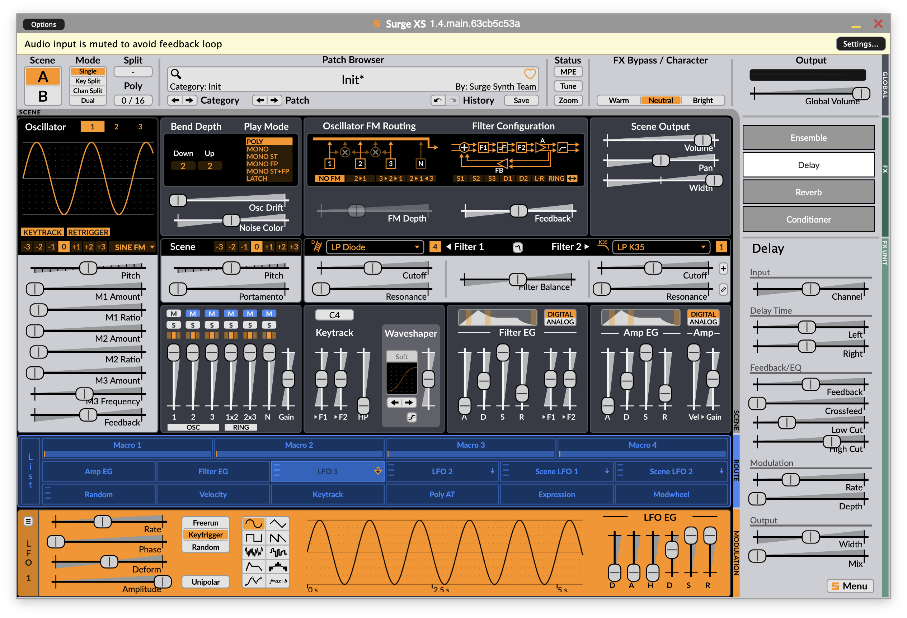

# Surge XS

Surge XS is a simplification of Surge XT, a free and open-source hybrid synthesizer, originally written and sold as a commercial product by @kurasu/Claes
Johanson at [Vember Audio](http://vemberaudio.se).

This readme serves as the root of developer documentation for Surge XS.



## Motivation

Surge is close to being the absolute best Open Source virtual synthesizer in my opinion. The team has made a lot of work to bring it up to speed compatibility-wise, and they have added cool things.

But I think it got too complex. It is not an intuitive synth to use, and having too many options made it worse. It is difficult to recommend to newbies, and it's not curated for daily use either.

Surge XS is my attempt to mitigate this. I love when software does simple things well, and I believe Surge can become like that.

## Roadmap

This is a constantly changing list of modifications that I want to do.

- [x] Remove Surge FX, Python and Rust bindings.
- [x] Remove Airwindows stuff
- [x] Select effects, filters and oscillators to keep.
   - Wanted FXs: Ensemble, Delay, Reverb and Conditioner.
   - Wanted filters:
      - Lowpass: OB-Xd 12 dB, Diode Ladder, K35.
      - Bandpass: 12 dB.
      - Highpass: 24 dB.
   - Wanted oscillators: Classic Sawtooth (rename to Saw), Classic Square (rename to Square), FM3 (rename to Sine FM).
- [x] Remove unwanted FXs from the UI.
- [x] Remove unwanted filters from the UI.
- [x] Remove unwanted oscillators from UI.
- [x] Remove unwanted FXs from the codebase.
- [x] Remove unwanted filters from the codebase.
- [x] Remove unwanted oscillators from codebase.
- [x] Simplify waveshaper.
- [x] Remove right-click menu parameter name and help link.
- [ ] Remove patch functionality.
- [x] Simplify FX chain. Hardcode 4 serial FXs (ensemble, delay, reverb and conditioner).
- [ ] Simplify filter routing, only one filter.
- [x] Simplify modulation source panel.
- [ ] Simplify LFOs (TBD).
- [ ] Reorder GUI items. Make space for visualizations.
- [ ] Add filter shape visualization.

# Developing Surge XS

_From here on, this is the documentation straight from Surge Team. I did a few modifications, especially removing stuff that I don't need._

Just do:

```
git clone https://github.com/surge-synthesizer/surge.git
cd surge
git submodule update --init --recursive
cmake -Bbuild -DCMAKE_BUILD_TYPE=Release
cmake --build build --config Release --target surge-staged-assets
```

This will build all the Surge XS (with XT naming) binary assets in the directory `build/surge_xt_products` and is often enough of a formula
to do a build.

> [!TIP]
> To only build the VST3, replace the above final command with this:
```bash
cmake --build build --config Release --target surge-xt_VST3
```

## Building an Installer

The CMake target `surge-xt-distribution` builds an install image on your platform at the end of the build process. On
Mac and Linux, the installer generator is built into the platform; on Windows, [Inno Setup](https://jrsoftware.org/isinfo.php)
and [7-Zip](https://7-zip.org/) should be on your PATH. The directory containing `7z.exe` (normally `C:\Program Files\7-Zip`)
and the directory containing `ISCC.exe` (normally `C:\Program Files (x86)\Inno Setup 6`) must be in your
PATH environment variable.

## Using CMake on the Command Line for More

We have a variety of other CMake options and targets which can allow you to develop and install Surge XS more easily.

### Plugin Development

JUCE supports a mode where a plugin (AU, VST3, etc...) is copied to a local install area after a build. This is off by
default with CMake, but you can turn it on with `-DSURGE_COPY_AFTER_BUILD=True` at `cmake` time.
If you do this on Unixes, building the VST3 or AU targets will copy them to the appropriate local area
(`~/.vst3` on Linux, `~/Library/Audio/Plugins` on Mac). On Windows it will attempt to install the VST3, so setting this
option may require administrator privileges in your build environment.

### CMake Install Targets (Linux and other non-Apple Unixes only)

On systems which are `UNIX AND NOT APPLE`, the CMake file provides an install target which will install all needed
assets to the `CMAKE_INSTALL_PREFIX`. This means a complete install can be accomplished by:

```
cmake -Bignore/sxt -DCMAKE_BUILD_TYPE=Release -DCMAKE_INSTALL_PREFIX=/usr
cmake --build ignore/sxt --config Release --parallel 8
sudo cmake --install ignore/sxt
```

and you should get a working install in `/usr/bin`, `/usr/share` and `/usr/lib`.

## Platform-specific Choices

### Building a Mac Fat Binary (ARM/Intel)

To build a fat binary on a Mac, simply add the following CMake argument to your initial CMake run:

```
-D"CMAKE_OSX_ARCHITECTURES=arm64;x86_64"
```

### Cross-compiling for aarch64

To cross-compile for aarch64, use the CMake Linux toolchain for aarch64, as shown in the Azure pipeline here:

```
cmake -Bignore/xc64 -DCMAKE_TOOLCHAIN_FILE=cmake/linux-aarch64-ubuntu-crosscompile-toolchain.cmake -DCMAKE_BUILD_TYPE=DEBUG -GNinja
cmake --build ignore/xc64 --config Debug --target surge-testrunner
```

Of course, that toolchain makes specific choices. You can make other choices as long as (1) you set the CMake variable
`LINUX_ON_ARM` and (2) you make sure your host and your target compiler are both 64-bit.

### Cross-compiling for macOS

Surge XS cross-compiles to macOS Intel from Linux and BSD.

1. Install [osxcross](https://github.com/tpoechtrager/osxcross). Make sure to also install the `libclang_rt` library
   built by their `build_compiler_rt.sh` script.
2. Configure and build Surge XS:

```
cmake -DCMAKE_TOOLCHAIN_FILE=cmake/x86_64-apple-darwin20.4-clang.cmake -DCMAKE_FIND_ROOT_PATH=<path_to_osxcross_sdk> -Bbuild
cmake --build build
```

# Setting up for Your OS

## Windows

You need to install the following:

* Install [Git](https://git-scm.com/downloads)
* Install [Visual Studio 2017, 2019, or later (version 15.5 or newer)](https://visualstudio.microsoft.com/downloads/)
     * When installing Visual Studio, make sure to include CLI tools and CMake, which are included in
  'Optional CLI support' and 'Toolset for desktop' install bundles.
  This is normally as simple as going to Visual Studio Installer and installing 'Desktop development with C++' from the 'Workloads' tab.

## macOS

To build on macOS, you need `Xcode`, `Xcode Command Line Utilities`, and CMake. Once you have installed
`Xcode` from the App Store, the command line to install the `Xcode Command Line Utilities` is:

```
xcode-select --install
```

There are a variety of ways to install CMake. If you use [homebrew](https://brew.sh), you can:

```
brew install cmake
```

## Linux

Most Linux systems have CMake, Git and a modern C++ compiler installed. Make sure yours does. We test with most gccs
older than 7 or so and clangs after 9 or 10. You will also need to install a set of dependencies. If you use `apt`, do:

```bash
sudo apt install build-essential git cmake libcairo-dev libxkbcommon-x11-dev libxkbcommon-dev libxcb-cursor-dev libxcb-keysyms1-dev libxcb-util-dev libxrandr-dev libxinerama-dev libxcursor-dev libasound2-dev libjack-jackd2-dev
```

*You can find more info about Surge XS on Linux and other Unix-like distros in [this document](doc/Linux%20and%20Other%20Unix-like%20Distributions.md).*
